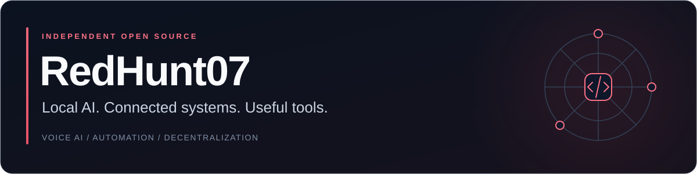

<p align="center">
  
</p>

<p align="center">
  <a href="https://github.com/redhunt07/dsh-voice-conversation"></a>
  <a href="https://github.com/redhunt07/ha-addon-vevor-eml3500-24l-rs232-wifi"></a>
  <a href="https://github.com/redhunt07/Fedi3"></a>
</p>

I build and maintain open-source tools that connect AI, software and real hardware. My projects span **local inference**, **hands-free voice interfaces**, **home automation** and **decentralized social systems**.

I care about clear setup instructions, useful diagnostics and making projects easier to run and improve.

### Featured projects

| Project | What it does | Explore |
| :--- | :--- | :--- |
| **[DSH Voice Conversation](https://github.com/redhunt07/dsh-voice-conversation)** | Hands-free Italian/English conversations for DeepSeek Harness, with a compact chat dock and optional local speech models. | [Install & docs](https://github.com/redhunt07/dsh-voice-conversation#install) · [npm](https://www.npmjs.com/package/dsh-voice-conversation) |
| **[DS4 · DSpark GB10](https://github.com/redhunt07/ds4-DSpark-GB10)** | A fork of antirez/ds4 focused on local DeepSeek inference and DSpark decoding on NVIDIA DGX Spark / GB10. | [Build & benchmarks](https://github.com/redhunt07/ds4-DSpark-GB10#readme) |
| **[FEDI3](https://github.com/redhunt07/Fedi3)** | A federated social project combining a Flutter app, a Rust core, P2P components and a relay. | [Project & setup](https://github.com/redhunt07/Fedi3#readme) |
| **[VEVOR → Home Assistant](https://github.com/redhunt07/ha-addon-vevor-eml3500-24l-rs232-wifi)** | Inverter telemetry and MQTT discovery through an RS232-to-WiFi bridge. | [Installation & configuration](https://github.com/redhunt07/ha-addon-vevor-eml3500-24l-rs232-wifi#installation) |

### Try the voice project

Speak, pause and let DSH submit your prompt. The plugin keeps the chat and tool activity visible, then resumes listening after the spoken reply.

```sh
dsh plugin --profile web add dsh-voice-conversation@0.1.1
```

**Start with the [setup guide](https://github.com/redhunt07/dsh-voice-conversation#readme)** — local speech needs its optional backend or configured compatible endpoints. The current tested target is DSH 0.2.0-rc.2 on Linux; check the project notes for limitations.

[](https://www.npmjs.com/package/dsh-voice-conversation) [](https://github.com/redhunt07/dsh-voice-conversation/actions/workflows/test.yml) [](https://dsh-plugin.org/plugins/redhunt07/dsh-voice-conversation)

### Work with me

Useful contributions are welcome: **reproducible bug reports, hardware tests, documentation improvements, translations and focused pull requests**.

- **Found a problem?** Open an issue in the relevant project with the version, environment and steps to reproduce it. Please leave credentials and private logs out of reports.
- **Have an idea?** Describe the use case first, so we can discuss the smallest useful change.
- **Want to follow development?** Star the project you find useful, or use **Watch → Custom → Releases** for release notifications.

For project questions and collaboration, use the relevant repository's issues. **Italian and English are both welcome.**

---

<sub>Built in the open. Original projects and forks are identified in their repositories; upstream authors and licenses are credited there.</sub>
